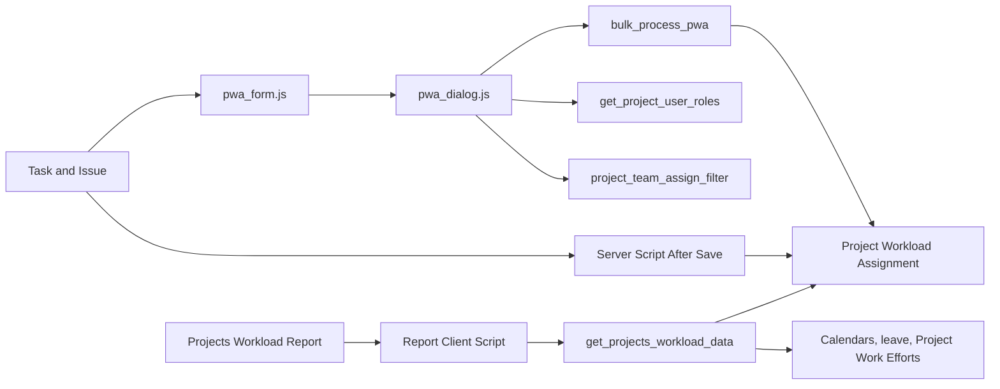

[Русский](README.ru.md)

# project_workload_assignment

`project_workload_assignment` is a Frappe application for managing and visualizing participant workload across projects and tasks. It adds a dedicated workload assignment DocType, extends the `Task` and `Issue` forms, and provides a separate `Projects Workload Report` screen.

The canonical owner of planned work effort and utilization: `Project Work Efforts` / `Project Work Efforts Amount`, `Limit Control`, `Worker Utilization Table`, `Project Utilization Table` and related Project Custom Fields. Depends on `dinext_projects`, `dinext_projects_pl` and `dinext_timesheets` (`Worker`).

A key characteristic of the repository is that a substantial portion of its business logic is implemented in `hooks.py`, client scripts and exported `Server Script` / `Client Script` fixtures, rather than Python controllers. These files are the main source of truth for application maintenance and development.

## What the application does

- Creates the `Project Workload Assignment` entity to store workload assignments for the `Task -> Project Role -> User` relationship.
- Supports three ways of specifying workload:
  - working hours;
  - a percentage of available working hours;
  - a percentage of task effort.
- Embeds the workload assignment interface in the `Task` and `Issue` forms.
- Supports bulk assignment of project team members and synchronizes these assignments with `ToDo`.
- Provides a separate `Projects Workload Report` screen with filters by participant, project and user group.
- Calculates workload accounting for calendars, available hours, leave, template-based working hours and planned effort by role.

## Core entities

### `Project Workload Assignment`

The application's main user-facing DocType. Stores:

- the `Task`;
- the `Project Role`;
- the `User`;
- the date range;
- the workload calculation type;
- the numeric workload value;
- the separate accounting flag.

Permissions in the current schema:

- `System Manager`: read, create, update, delete, export, print, reports;
- `Dinext_User`: read and update existing records, export, print, reports.

### `Projects Workload Report`

A Single DocType wrapper for the custom report screen. The document itself stores only filters and a container for rendering the table:

- `user`;
- `project`;
- `user_group`;
- the internal `projects_workload_report` container field.

Permissions in the current schema:

- `System Manager`: read, create, update, delete.

## How it works

### 1. Working from `Task` and `Issue`

The application includes `project_workload_assignment/public/js/assignment/form.js` as `doctype_js` for `Task` and `Issue`.

- For `Task`, the workload assignment dialog opens directly from the form.
- For `Issue`, the related task is first found through `custom_linked_issue`, then the same dialog opens.
- If the form has unsaved changes, the user is prompted to save the document before opening the dialog.

### 2. Workload assignment dialog

The global dialog workflow is implemented in `project_workload_assignment/public/js/assignment/dialog.js`.

When the dialog opens, the system:

- retrieves existing `Project Workload Assignment` records for the task;
- requests effort limits through `calculate_timesheet_limits`;
- loads the task's current `ToDo` records;
- offers to add missing assignees;
- lets you assign one user or the entire project team;
- restricts the role list to the user's roles in the project team;
- validates and highlights rows with potentially problematic workload;
- sends all changes through the `bulk_process_pwa` API when saving.

On the server, `bulk_process_pwa`:

- creates new `Project Workload Assignment` records;
- updates existing ones;
- deletes records marked for deletion;
- then synchronizes the task's `ToDo` assignments with the final set of assignees.

### 3. Automatic date updates

The exported `Server Script` fixtures contain `After Save` handlers for `Task` and `Issue`.

- If an assignment has `task_dates` enabled, its `date_from` / `date_to` dates update automatically when the task dates change.
- For `Issue`, the update operates through the related task.

### 4. Workload report

The report screen is built by the `Projects Workload Report_V3` client script from `project_workload_assignment/fixtures/client_script.json`.

The report:

- renders as a custom table based on `StickyDataTable`;
- supports `daily`, `weekly`, `monthly` views;
- supports `quarter`, `half_year`, `year` ranges;
- lets you filter data by user, project and user group;
- adds separate leave rows;
- displays person-hours, workload percentage and the visual state of each cell;
- can open project workload or a leave application on double-click.

Server-side aggregation is performed by the `get_projects_workload_data` API from `project_workload_assignment/fixtures/server_script.json`.

The calculation accounts for:

- assignments from `Project Workload Assignment`;
- project calendars and user holiday lists;
- leave from `Application For Leave`;
- user working hours and date-specific overrides;
- planned effort from `Project Work Efforts` / `Project Work Efforts Amount`;
- project team membership and participant roles.

## Architecture



## Frappe extension points

Key integrations are declared in `project_workload_assignment/hooks.py`:

- Desk module: `Project Workload Assignment` (`modules.txt`);
- global CSS: `/assets/project_workload_assignment/css/assignment_styles.css`;
- global JS: `/assets/project_workload_assignment/js/assignment/dialog.js` (+ `workload-reports/report-form/entry.js`);
- `doctype_js` for `Task` and `Issue`: `public/js/assignment/form.js`;
- fixtures:
  - `Server Script` for the `Project Workload Assignment` module;
  - `Client Script` for the `Project Workload Assignment` module.

This means that after fixture or client asset changes, it is important to check the exported workflows in JSON and JS files as well as the Python code.

## Requirements

Requirements confirmed by the repository and code:

- Python `>= 3.10`;
- a Frappe / Bench environment;
- an existing site where the application can be installed;
- availability of the standard and custom DocTypes used by the logic:
  - `Task`;
  - `Issue`;
  - `ToDo`;
  - `Project`;
  - `Project Role`;
  - `User`;
  - `User Group`;
  - `Project Team Details`;
  - `Application For Leave`;
  - `Project Work Efforts`;
  - `Project Work Efforts Amount`;
  - `Worker`;
  - `Timesheet Template`;
  - `Working Hours On Date`.

The code also expects external dependencies in the main ERP environment:

- the frontend asset `/assets/dinext_common/js/sticky-datatable.js`;
- the `calculate_timesheet_limits` server method;
- the utility method `dinord_erpnext_customization.dinord_erpnext_customization.utils.user.get_users_with_role`.

If these dependencies are missing in the environment, some interface and report scenarios will not work.

## Installation

Installation uses `bench`:

```bash
cd $PATH_TO_YOUR_BENCH
bench get-app $URL_OF_THIS_REPO --branch develop
bench --site <site_name> install-app project_workload_assignment
bench --site <site_name> migrate
```

If the application is already added to bench as a local app, the following is sufficient:

```bash
cd $PATH_TO_YOUR_BENCH
bench --site <site_name> install-app project_workload_assignment
bench --site <site_name> migrate
```

For local development, the following is also commonly used:

```bash
bench start
```

## Quick usage scenario

### For a user

1. Open a `Task` or `Issue` associated with a project.
2. Launch the workload assignment dialog from the form's assignments block.
3. Add one assignee or assign the entire project team.
4. Specify a role, period and workload type for each row.
5. Save the changes to update `Project Workload Assignment` and synchronize `ToDo`.
6. Open `Projects Workload Report` to view total workload by participant and project.

### For a developer or implementation team

When investigating the application's behavior, start in this order:

1. `project_workload_assignment/hooks.py`
2. `project_workload_assignment/public/js/assignment/form.js`
3. `project_workload_assignment/public/js/assignment/dialog.js`
4. `project_workload_assignment/fixtures/server_script.json`
5. `project_workload_assignment/fixtures/client_script.json`
6. `project_workload_assignment/project_workload_assignment/doctype/*/*.json`

The Python controllers and tests are currently mostly scaffolding, so the main behavior is in the files listed above.

## Development

### Repository setup

The repository is configured with `pre-commit`:

```bash
cd apps/project_workload_assignment
pre-commit install
```

Checks and formatting:

- `ruff` and import sorting;
- `ruff-format`;
- `eslint`;
- `prettier`;
- basic `pre-commit-hooks`.

Run manually:

```bash
cd apps/project_workload_assignment
pre-commit run --all-files
```

### Tests

The repository contains Frappe test stubs for both DocTypes. The basic command to run them is:

```bash
bench --site <site_name> run-tests --app project_workload_assignment
```

At present, the test classes exist but contain only scaffolding, without actual scenarios.

## Configuration and limitations

- No separate environment variables were found in the repository.
- A significant portion of the logic is stored in fixtures, so changes made through the Frappe UI may not reach git without a subsequent export.
- `Projects Workload Report` depends on client-side rendering and the external `StickyDataTable` component.
- The application is licensed under GNU GPL v3; the full text is in `license.txt`.
- The `pre_model_sync` and `post_model_sync` sections in `patches.txt` are currently empty.

## Repository structure

```text
project_workload_assignment/
├── README.md
├── pyproject.toml
├── .pre-commit-config.yaml
├── .eslintrc
├── license.txt
└── project_workload_assignment/
    ├── __init__.py
    ├── hooks.py
    ├── modules.txt
    ├── patches.txt
    ├── fixtures/
    │   ├── client_script.json
    │   └── server_script.json
    ├── public/
    │   ├── css/
    │   │   └── assignment_styles.css
    │   └── js/
    │       ├── assignment/
    │       ├── work_efforts/
    │       └── workload-reports/
    └── project_workload_assignment/
        └── doctype/
            ├── project_workload_assignment/
            │   ├── project_workload_assignment.json
            │   ├── project_workload_assignment.py
            │   ├── project_workload_assignment.js
            │   └── test_project_workload_assignment.py
            └── projects_workload_report/
                ├── projects_workload_report.json
                ├── projects_workload_report.py
                ├── projects_workload_report.js
                └── test_projects_workload_report.py
```

Directory purposes in brief:

- `project_workload_assignment/hooks.py` — registration of the application's Frappe integrations.
- `project_workload_assignment/fixtures/` — exported server and client workflows containing a significant portion of the business logic.
- `project_workload_assignment/public/js/` — application frontend for the workload assignment form and user scenarios.
- `project_workload_assignment/public/css/` — styles for assignment dialogs and related elements.
- `project_workload_assignment/project_workload_assignment/doctype/` — custom DocType schemas, their Python controllers and test scaffolding.

## Where to make changes by task type

- To change how the dialog opens from `Task` / `Issue`:
  - `project_workload_assignment/public/js/assignment/form.js`
- To change the workload assignment UI or validation:
  - `project_workload_assignment/public/js/assignment/dialog.js`
  - `project_workload_assignment/public/css/assignment_styles.css`
- To change server-side saving, calculation or synchronization:
  - `project_workload_assignment/fixtures/server_script.json`
- To change the report interface:
  - `project_workload_assignment/fixtures/client_script.json`
- To change document fields, permissions or structure:
  - `project_workload_assignment/project_workload_assignment/doctype/.../*.json`

## License

`hooks.py` specifies the GNU GPL v3 license. See [license.txt](license.txt) for the full text.
