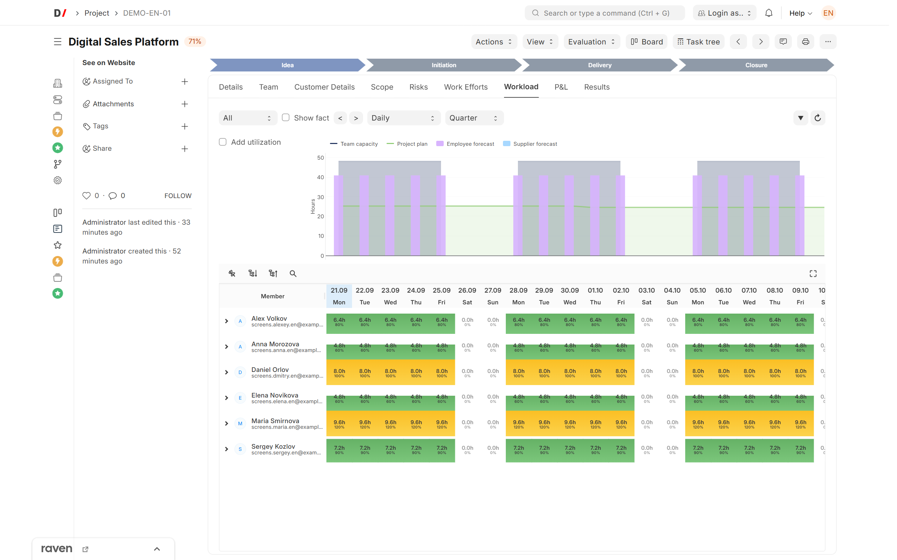
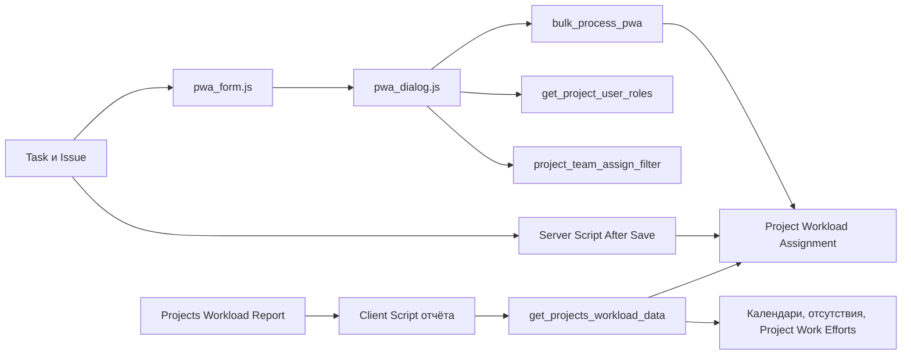

[English](README.md)

<!-- dinext-presentation:start -->
<p align="center">
  <a href="https://dinext.ru"></a>
</p>
<h1 align="center">Dinext Project Workload Assignment</h1>

<hr>

<p align="center">Назначение трудозатрат, балансировка загрузки команды и сравнение плановой занятости с доступной ёмкостью.</p>

<p align="center">
  
</p>
<p align="center"><sub>Планирование загрузки и ёмкости команды с учебными учётными записями.</sub></p>

<p align="center">
  <a href="https://dinext.ru">Сайт</a> · <a href="https://docs.dinext.ru">Документация</a>
</p>
<!-- dinext-presentation:end -->

# project_workload_assignment

`project_workload_assignment` — Frappe-приложение для управления и визуализации загрузки участников по проектам и задачам. Приложение добавляет собственный DocType назначения загрузки, расширяет формы `Task` и `Issue`, а также предоставляет отдельный экран отчёта `Projects Workload Report`.

Канонический владелец плановых трудозатрат и утилизации: `Project Work Efforts` / `Project Work Efforts Amount`, `Limit Control`, `Worker Utilization Table`, `Project Utilization Table` и связанные Project Custom Fields. Зависит от `dinext_projects`, `dinext_projects_pl` и `dinext_timesheets` (`Worker`).

Ключевая особенность репозитория: заметная часть бизнес-логики реализована не в Python-контроллерах, а в `hooks.py`, клиентских скриптах и экспортированных `Server Script` / `Client Script` fixtures. Для сопровождения и доработки приложения именно эти файлы являются основным источником правды.

## Что делает приложение

- Создаёт сущность `Project Workload Assignment` для хранения назначения загрузки по связке `Task -> Project Role -> User`.
- Позволяет задавать загрузку в трёх режимах:
  - в рабочих часах;
  - в процентах от фонда рабочих часов;
  - в процентах от трудоёмкости задачи.
- Встраивает интерфейс назначения загрузки в формы `Task` и `Issue`.
- Позволяет массово назначать исполнителей проекта и синхронизировать эти назначения с `ToDo`.
- Предоставляет отдельный экран `Projects Workload Report` с фильтрами по участнику, проекту и группе пользователей.
- Рассчитывает нагрузку с учётом календарей, доступных часов, отсутствий, рабочих часов по шаблонам и плановых трудозатрат по ролям.

## Основные сущности

### `Project Workload Assignment`

Основной пользовательский DocType приложения. Хранит:

- задачу `Task`;
- роль проекта `Project Role`;
- пользователя `User`;
- диапазон дат;
- тип расчёта загрузки;
- числовое значение загрузки;
- флаг отдельного учёта.

Права в текущей схеме:

- `System Manager`: чтение, создание, изменение, удаление, экспорт, печать, отчёты;
- `Dinext_User`: чтение и изменение существующих записей, экспорт, печать, отчёты.

### `Projects Workload Report`

Single DocType-оболочка для пользовательского экрана отчёта. Сам документ хранит только фильтры и контейнер для рендера таблицы:

- `user`;
- `project`;
- `user_group`;
- служебное поле контейнера `projects_workload_report`.

Права в текущей схеме:

- `System Manager`: чтение, создание, изменение, удаление.

## Как это работает

### 1. Работа из `Task` и `Issue`

Приложение подключает `project_workload_assignment/public/js/assignment/form.js` как `doctype_js` для `Task` и `Issue`.

- Для `Task` диалог назначения загрузки открывается прямо из формы.
- Для `Issue` сначала ищется связанная задача по полю `custom_linked_issue`, после чего открывается тот же диалог.
- Если форма изменена, перед открытием диалога пользователю предлагается сохранить документ.

### 2. Диалог назначения загрузки

Глобальный сценарий диалога реализован в `project_workload_assignment/public/js/assignment/dialog.js`.

При открытии диалога система:

- получает существующие записи `Project Workload Assignment` по задаче;
- запрашивает ограничения по трудозатратам через `calculate_timesheet_limits`;
- подтягивает текущие `ToDo` по задаче;
- предлагает добавить недостающих исполнителей;
- позволяет назначить одного пользователя или всю команду проекта;
- ограничивает список ролей ролями пользователя в команде проекта;
- валидирует и подсвечивает строки с потенциально проблемной загрузкой;
- при сохранении отправляет все изменения через API `bulk_process_pwa`.

`bulk_process_pwa` на стороне сервера:

- создаёт новые записи `Project Workload Assignment`;
- обновляет существующие;
- удаляет помеченные записи;
- после этого синхронизирует `ToDo` назначения задачи с итоговым составом исполнителей.

### 3. Автообновление дат

В экспортированных `Server Script` fixtures есть обработчики `After Save` для `Task` и `Issue`.

- Если у назначения включён флаг `task_dates`, даты `date_from` / `date_to` автоматически обновляются при изменении дат задачи.
- Для `Issue` обновление работает через связанную задачу.

### 4. Отчёт по загрузке

Экран отчёта строится клиентским скриптом `Projects Workload Report_V3` из `project_workload_assignment/fixtures/client_script.json`.

Отчёт:

- рендерится как пользовательская таблица на базе `StickyDataTable`;
- поддерживает представления `daily`, `weekly`, `monthly`;
- поддерживает диапазоны `quarter`, `half_year`, `year`;
- позволяет фильтровать данные по пользователю, проекту и группе пользователей;
- добавляет отдельные строки отсутствий;
- показывает человеко-часы, процент загрузки и визуальное состояние ячейки;
- по двойному клику умеет открывать загрузку проекта или заявку на отсутствие.

Серверная агрегация выполняется API `get_projects_workload_data` из `project_workload_assignment/fixtures/server_script.json`.

Расчёт учитывает:

- назначения из `Project Workload Assignment`;
- проектные календари и пользовательские holiday lists;
- отсутствия из `Application For Leave`;
- рабочие часы пользователя и переопределения по датам;
- плановые трудозатраты из `Project Work Efforts` / `Project Work Efforts Amount`;
- состав проектной команды и роли участников.

## Архитектура



## Точки расширения Frappe

Ключевые интеграции объявлены в `project_workload_assignment/hooks.py`:

- модуль Desk: `Project Workload Assignment` (`modules.txt`);
- глобальный CSS: `/assets/project_workload_assignment/css/assignment_styles.css`;
- глобальный JS: `/assets/project_workload_assignment/js/assignment/dialog.js` (+ `workload-reports/report-form/entry.js`);
- `doctype_js` для `Task` и `Issue`: `public/js/assignment/form.js`;
- fixtures:
  - `Server Script` для модуля `Project Workload Assignment`;
  - `Client Script` для модуля `Project Workload Assignment`.

Это означает, что после изменений в fixtures или клиентских ресурсах важно проверять не только Python-код, но и экспортированные сценарии в JSON и JS-файлах.

## Требования

Подтверждённые требования из репозитория и кода:

- Python `>= 3.10`;
- Frappe / Bench-окружение;
- установленный сайт, на который можно поставить приложение;
- доступность стандартных и кастомных DocType, используемых в логике:
  - `Task`;
  - `Issue`;
  - `ToDo`;
  - `Project`;
  - `Project Role`;
  - `User`;
  - `User Group`;
  - `Project Team Details`;
  - `Application For Leave`;
  - `Project Work Efforts`;
  - `Project Work Efforts Amount`;
  - `Worker`;
  - `Timesheet Template`;
  - `Working Hours On Date`.

Также код ожидает наличие внешних зависимостей на стороне основного ERP-окружения:

- фронтенд-ресурс `/assets/dinext_common/js/sticky-datatable.js`;
- серверный метод `calculate_timesheet_limits`;
- utility-метод `dinord_erpnext_customization.dinord_erpnext_customization.utils.user.get_users_with_role`.

Если этих зависимостей нет в стенде, часть сценариев интерфейса и отчёта работать не будет.

## Установка

Установка выполняется через `bench`:

```bash
cd $PATH_TO_YOUR_BENCH
bench get-app $URL_OF_THIS_REPO --branch develop
bench --site <site_name> install-app project_workload_assignment
bench --site <site_name> migrate
```

Если приложение уже добавлено в bench как локальный app, достаточно:

```bash
cd $PATH_TO_YOUR_BENCH
bench --site <site_name> install-app project_workload_assignment
bench --site <site_name> migrate
```

Для локальной разработки обычно также используют:

```bash
bench start
```

## Быстрый сценарий использования

### Для пользователя

1. Откройте `Task` или `Issue`, связанные с проектом.
2. Запустите диалог назначения загрузки через блок назначений на форме.
3. Добавьте одного исполнителя или назначьте всю команду проекта.
4. Для каждой строки задайте роль, период и тип загрузки.
5. Сохраните изменения, чтобы обновить `Project Workload Assignment` и синхронизировать `ToDo`.
6. Откройте `Projects Workload Report` для просмотра суммарной загрузки по участникам и проектам.

### Для разработчика или внедрения

При разборе поведения приложения начинать стоит в таком порядке:

1. `project_workload_assignment/hooks.py`
2. `project_workload_assignment/public/js/assignment/form.js`
3. `project_workload_assignment/public/js/assignment/dialog.js`
4. `project_workload_assignment/fixtures/server_script.json`
5. `project_workload_assignment/fixtures/client_script.json`
6. `project_workload_assignment/project_workload_assignment/doctype/*/*.json`

Python-контроллеры и тесты сейчас в основном каркасные, поэтому основное поведение находится именно в перечисленных выше файлах.

## Разработка

### Подготовка репозитория

В репозитории настроен `pre-commit`:

```bash
cd apps/project_workload_assignment
pre-commit install
```

Проверки и форматирование:

- `ruff` и сортировка импортов;
- `ruff-format`;
- `eslint`;
- `prettier`;
- базовые `pre-commit-hooks`.

Запуск вручную:

```bash
cd apps/project_workload_assignment
pre-commit run --all-files
```

### Тесты

В репозитории присутствуют Frappe test stubs для обоих DocType. Базовая команда запуска:

```bash
bench --site <site_name> run-tests --app project_workload_assignment
```

На текущий момент тестовые классы существуют, но содержат только каркас без фактических сценариев.

## Конфигурация и ограничения

- Отдельные переменные окружения в репозитории не обнаружены.
- Значимая часть логики хранится в fixtures, поэтому изменения через UI Frappe без последующего экспорта могут не попасть в git.
- `Projects Workload Report` зависит от клиентского рендера и внешнего компонента `StickyDataTable`.
- Лицензия приложения — GNU GPL v3, полный текст в `license.txt`.
- В `patches.txt` секции `pre_model_sync` и `post_model_sync` пока пустые.

## Структура репозитория

```text
project_workload_assignment/
├── README.md
├── pyproject.toml
├── .pre-commit-config.yaml
├── .eslintrc
├── license.txt
└── project_workload_assignment/
    ├── __init__.py
    ├── hooks.py
    ├── modules.txt
    ├── patches.txt
    ├── fixtures/
    │   ├── client_script.json
    │   └── server_script.json
    ├── public/
    │   ├── css/
    │   │   └── assignment_styles.css
    │   └── js/
    │       ├── assignment/
    │       ├── work_efforts/
    │       └── workload-reports/
    └── project_workload_assignment/
        └── doctype/
            ├── project_workload_assignment/
            │   ├── project_workload_assignment.json
            │   ├── project_workload_assignment.py
            │   ├── project_workload_assignment.js
            │   └── test_project_workload_assignment.py
            └── projects_workload_report/
                ├── projects_workload_report.json
                ├── projects_workload_report.py
                ├── projects_workload_report.js
                └── test_projects_workload_report.py
```

Краткое назначение каталогов:

- `project_workload_assignment/hooks.py` — регистрация интеграций приложения в Frappe.
- `project_workload_assignment/fixtures/` — экспортированные серверные и клиентские сценарии, содержащие значительную часть бизнес-логики.
- `project_workload_assignment/public/js/` — прикладной фронтенд для формы назначения загрузки и пользовательских сценариев.
- `project_workload_assignment/public/css/` — стили для диалогов назначения и связанных элементов.
- `project_workload_assignment/project_workload_assignment/doctype/` — схемы кастомных DocType, их Python-контроллеры и тестовые заготовки.

## Где искать изменения по типам задач

- Нужно изменить поведение открытия диалога из `Task` / `Issue`:
  - `project_workload_assignment/public/js/assignment/form.js`
- Нужно изменить UI или валидацию назначения загрузки:
  - `project_workload_assignment/public/js/assignment/dialog.js`
  - `project_workload_assignment/public/css/assignment_styles.css`
- Нужно изменить серверную обработку сохранения, расчёта или синхронизации:
  - `project_workload_assignment/fixtures/server_script.json`
- Нужно изменить интерфейс отчёта:
  - `project_workload_assignment/fixtures/client_script.json`
- Нужно изменить поля, права или структуру документов:
  - `project_workload_assignment/project_workload_assignment/doctype/.../*.json`

## Лицензия

В `hooks.py` указана лицензия GNU GPL v3. Полный текст — в [license.txt](license.txt).
